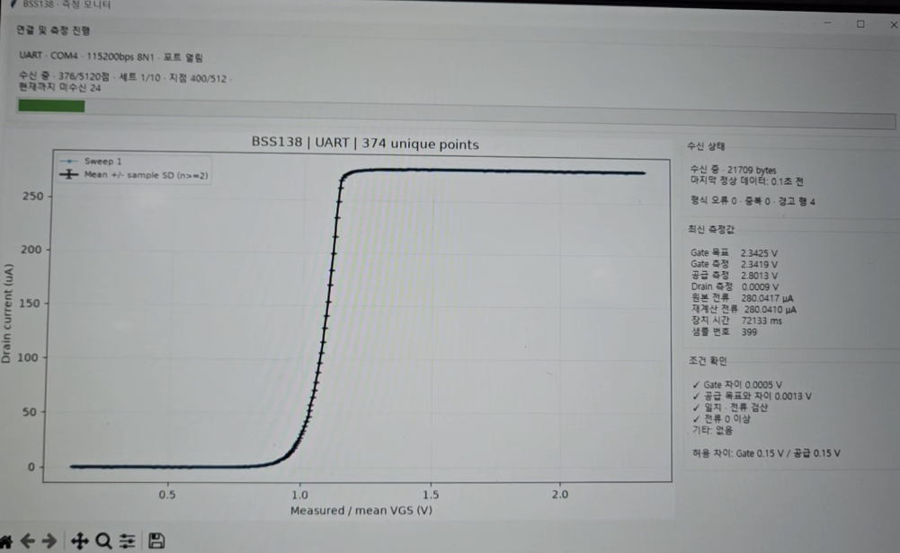

# MOSFET BSS138 I–V Measurement

STM32L432KC Nucleo 보드와 10 kΩ 저항으로 BSS138 N채널 MOSFET의 **전달 특성(`VGS–ID`)**과 **출력 특성(`VDS–ID`)**을 측정합니다. STM32가 DAC로 게이트와 드레인 쪽 공급 전압을 설정하고, ADC로 실측 전압을 읽어 드레인 전류를 계산합니다. 보드를 리셋하면 선택한 모드에서 측정을 시작하고 USART2로 CSV를 전송합니다.

## 측정 모드 선택

[Core/Inc/sweep_app.h](Core/Inc/sweep_app.h) 상단의 `MEASUREMENT_MODE` 한 줄에서 선택합니다.

```c
#define MEASUREMENT_MODE MEASUREMENT_MODE_VGS_ID
```

| 설정값 | 고정하는 전압 | 스윕하는 전압 | CSV 데이터 |
| --- | --- | --- | --- |
| `MEASUREMENT_MODE_VGS_ID` (`0`, 기본값) | 드레인 쪽 공급 DAC 2.8 V | 게이트 DAC 0~3.0 V | 512점 × 1회 |
| `MEASUREMENT_MODE_VDS_ID` (`1`) | 게이트 DAC를 곡선마다 0.9, 1.0, 1.1, 1.2 V로 고정 | 드레인 쪽 공급 DAC 0~2.8 V | 128점 × 4곡선 |

출력 특성을 측정하려면 오른쪽 값을 `MEASUREMENT_MODE_VDS_ID`로 바꿉니다. 설정을 저장한 뒤 **Debug로 다시 빌드하고 보드에 다운로드**해야 적용됩니다. 두 모드는 같은 배선을 사용합니다.

## 측정 예시



이 화면은 이전 10회 스윕 설정에서 첫 스윕을 진행하던 중 캡처한 예시입니다. 실측 게이트-소스 전압이 약 0.9~1.2 V인 구간에서 전류가 빠르게 증가하고, 드레인 전압이 0 V에 가까워지면서 전류는 2.8 V 공급과 10 kΩ 부하로 정해지는 약 280 µA에 접근합니다. 현재 펌웨어는 부팅할 때 512점 스윕을 한 번 수행합니다.

## 회로 연결


드레인 전류 경로는 `DAC2 → 10 kΩ → BSS138 드레인 → 소스 → GND`입니다.

| Nucleo 핀 | STM32 기능 | 연결 |
| --- | --- | --- |
| A4 (PA5) | DAC1 CH2 | 10 kΩ 저항의 공급 쪽 구동. 모드에 따라 2.8 V로 고정하거나 0~2.8 V 스윕 |
| A1 (PA1) | ADC1 IN6 | 저항의 공급 쪽 전압 측정 |
| A0 (PA0) | ADC1 IN5 | 저항의 드레인 쪽 전압 측정 |
| A3 (PA4) | DAC1 CH1 | MOSFET 게이트 전압 설정 |
| A2 (PA3) | ADC1 IN8 | MOSFET 게이트 전압 측정 |
| GND | 공통 접지 | MOSFET 소스 |

MOSFET 소스를 MCU GND에 연결하므로 A2에서 읽은 게이트 전압은 `VGS`, A0에서 읽은 드레인 전압은 `VDS`입니다. A1은 저항 위쪽 전압인 `VSupply`를 읽습니다.

```text
ID_uA = (VSupply − VDrain) × 1,000,000 / 10,000
```

배치도의 공급 노드에 표시된 **2.8 V**는 게이트 스윕의 설정값입니다. 출력 특성 모드에서는 같은 노드를 0~2.8 V로 스윕합니다.

## 측정 동작

1. 부팅 후 ADC를 보정하고, 두 DAC 채널을 시작한 뒤 선택한 모드의 CSV 헤더를 전송합니다.
2. 각 점에서 DAC 설정 후 100 ms를 기다립니다. 공급·드레인·게이트 전압을 각각 16회 읽어 평균을 구합니다. 12비트 ADC 전압 변환에는 기준 전압 3.3 V를 가정합니다.
3. 드레인 전류를 계산해 UART로 한 줄을 보내고 50 ms 대기합니다. 기본 설정은 두 모드 모두 512점이며, 설정된 대기 시간만 합쳐 약 77초가 걸립니다. 실제 시간에는 ADC 변환과 UART 전송 시간이 추가됩니다.
4. 게이트 스윕이 끝나면 게이트 DAC 설정값을 0 V로 돌립니다. 출력 특성 모드는 곡선마다 공급 DAC를 0 V로 되돌리고 마지막에 게이트 DAC도 0 V로 설정합니다. 두 모드 모두 전체 측정을 마치면 `measurement_done_live`가 1이 됩니다. 다시 측정하려면 보드를 리셋합니다.

게이트 스윕 범위·점 수와 공통 측정 설정은 [sweep_app.h](Core/Inc/sweep_app.h)에 있습니다. 출력 특성 모드의 게이트 설정값과 공급 스윕 범위·점 수는 [vds_sweep_app.c](Core/Src/vds_sweep_app.c)에서 조정합니다.

## 빌드 및 실행

1. 저장소를 내려받아 STM32CubeIDE의 **File → Import → General → Existing Projects into Workspace**에서 프로젝트 폴더를 선택합니다.
2. `MEASUREMENT_MODE`를 선택하고 **Debug** 구성으로 빌드합니다. 이 구성에는 CSV 소수점 출력에 필요한 `-u _printf_float`가 설정되어 있습니다.
3. ST-LINK를 통해 보드에 펌웨어를 다운로드합니다.
4. 시리얼 터미널에서 보드의 COM 포트를 **115200 baud, 8N1, 흐름 제어 없음**으로 엽니다.
5. 터미널을 연 상태에서 보드를 리셋하고, 첫 줄의 CSV 헤더부터 측정이 끝날 때까지 저장합니다.

## UART CSV와 그래프

**게이트 스윕(`VGS–ID`)**

```csv
VGS_Set,VGS_Measured,VSupply,VDrain,ID_uA,time_ms,sample_id,sweep_id,point_index
```

가로축에 `VGS_Measured`, 세로축에 `ID_uA`를 놓습니다. 기본 설정의 `sweep_id`는 1입니다.

**출력 특성(`VDS–ID`)**

```csv
VGS_Set,VGS_Measured,VSupply_Set,VSupply,VDS_Measured,ID_uA,time_ms,sample_id,sweep_id,point_index
```

가로축에 `VDS_Measured`, 세로축에 `ID_uA`를 놓고 `sweep_id`(1~4)별로 곡선을 나눕니다. 각 곡선의 게이트 설정값은 `VGS_Set`에서 확인합니다. `VSupply_Set`은 DAC 설정값, `VSupply`는 저항 위쪽 실측값, `VDS_Measured`는 MOSFET 드레인-소스 사이의 실측 전압입니다.

두 형식 모두 전압은 V, 전류는 µA, `time_ms`는 부팅 후 경과 시간(ms)입니다. `sample_id`는 전체 측정에서 0부터 증가하고, `point_index`는 각 스윕에서 0부터 다시 시작합니다.

## 측정 한계

- **10 kΩ 부하가 측정 범위를 결정합니다.** 공급이 2.8 V이면 `VDS`가 0 V에 가까울 때 전류 상한은 약 280 µA입니다. 같은 공급에서 `VDS`가 2.0 V이면 가능한 전류는 약 80 µA까지입니다. 게이트를 충분히 열었을 때 출력 특성 데이터가 낮은 `VDS`에 몰릴 수 있습니다.
- **작은 전압차에는 오차가 크게 반영됩니다.** DAC의 영점 오차, ADC 채널 간 오프셋, 실제 기준 전압과 저항 공차가 결과에 영향을 줍니다.
- 출력 특성 모드는 공급 전압을 스윕하며 그때의 `VDS`를 읽습니다. 더 넓은 전류 범위나 목표 `VDS` 제어가 필요하면 [출력 특성 측정 문서](docs/vds-id.md)의 회로 확장 설명을 참고하세요.

## 프로젝트 구조

```text
MOSFET_BSS138_IV_measurement/
├── Core/
│   ├── Inc/                              # 헤더와 측정 설정
│   │   ├── sweep_app.h                   # 모드 선택, VGS 스윕과 공통 설정
│   │   ├── sweep_io.h                    # 두 모드가 공유하는 측정 함수 선언
│   │   └── vds_sweep_app.h               # VDS 스윕 진입 함수 선언
│   ├── Src/                              # 펌웨어 구현
│   │   ├── main.c                        # 주변장치 초기화와 모드 선택
│   │   ├── sweep_app.c                   # VGS 스윕과 공통 ADC·DAC·UART 처리
│   │   └── vds_sweep_app.c               # VDS 스윕과 출력 특성 CSV 전송
│   └── Startup/                          # MCU 시작 코드
├── Drivers/                              # STM32 HAL 및 CMSIS
├── docs/
│   ├── perfboard-wiring.png              # 만능기판 배치도
│   ├── bss138-measurement-example.png    # VGS–ID 측정 예시
│   └── vds-id.md                         # VDS–ID 설정, 배선 및 측정 한계
├── MOSFET_BSS138_IV_measurement.ioc      # CubeMX 핀·주변장치 설정
├── STM32L432KCUX_FLASH.ld                # 플래시 메모리 링커 스크립트
└── README.md
```

측정 모드를 바꾸려면 [sweep_app.h](Core/Inc/sweep_app.h)를 열면 됩니다. 실행 흐름은 [main.c](Core/Src/main.c)에서 시작해 [sweep_app.c](Core/Src/sweep_app.c)의 게이트 스윕 또는 [vds_sweep_app.c](Core/Src/vds_sweep_app.c)의 출력 특성 스윕으로 이어집니다.
