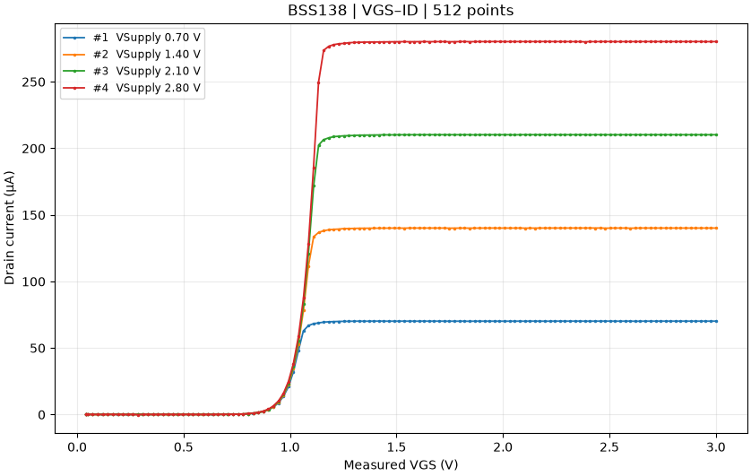
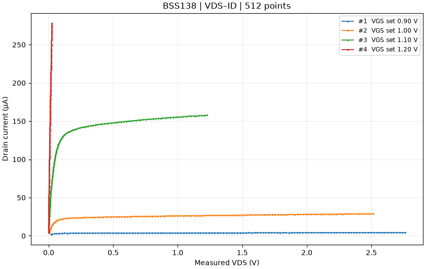
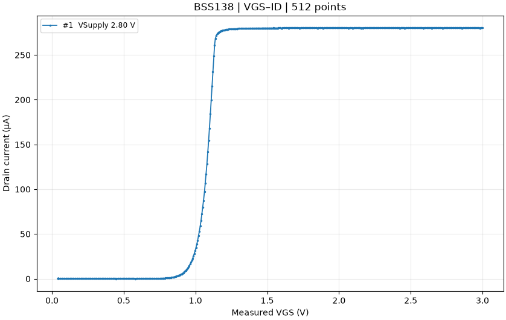
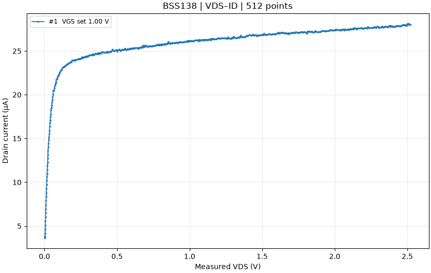
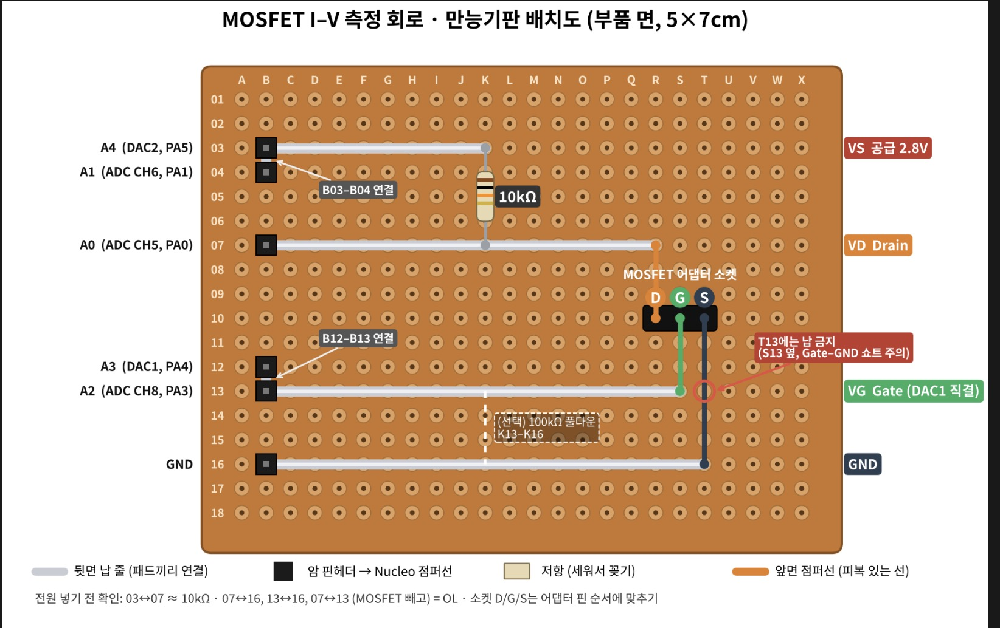

# MOSFET BSS138 I–V Measurement

**MOSFET에 걸리는 전압을 조금씩 바꾸면 전류는 어떻게 달라질까요?** 이 프로젝트는 STM32L432KC Nucleo 보드와 10 kΩ 저항으로 BSS138의 전류를 측정하고, PC에서 실시간 그래프로 보여줍니다. 같은 회로에서 게이트 전압에 따른 **전달 특성(`VGS–ID`)**과 드레인 전압에 따른 **출력 특성(`VDS–ID`)**을 관찰할 수 있습니다.

STM32의 **DAC**는 전압을 내보내고, **ADC**는 회로에 실제로 걸린 전압을 읽습니다. PC의 Python 프로그램은 USB 가상 COM 포트로 측정 명령을 보내고, STM32가 돌려주는 CSV 데이터를 그래프로 표시합니다.

**처음 실행하는 순서** · [준비물과 배선](#준비물과-배선) → [펌웨어 올리기](#빌드-및-실행) → [Python으로 측정하기](#python-실시간-uart-모니터)

## STM32를 사용하는 이유

이 실험에는 **서로 독립적으로 전압을 내보내는 출력 2개**와 **실측 전압을 읽는 입력 3개**가 필요합니다. STM32L432KC에는 12비트 DAC 2채널과 여러 입력을 순서대로 읽을 수 있는 12비트 ADC가 있어, 현재 저전압·저전류 실험에 외부 DAC나 ADC를 추가할 필요가 없습니다. Nucleo의 ST-LINK USB 연결로 펌웨어를 올리고, 같은 케이블의 가상 COM 포트로 명령과 결과를 주고받습니다. [STM32L432KC 데이터시트](https://www.st.com/resource/en/datasheet/stm32l432kc.pdf) · [Nucleo-32 사용자 매뉴얼](https://www.st.com/resource/en/user_manual/um1956-.pdf)

STM32는 **타이머로 ADC 스캔 시작 시점**을 정하고 **DMA로 변환값을 메모리에** 옮기도록 구성했습니다. Python은 모드 선택, 그래프, 저장을 담당합니다. 화면 갱신과 별개로 보드가 한 측정점 안의 ADC 스캔 간격을 정합니다.

## BSS138을 선정한 이유

- **STM32가 만들 수 있는 전압 범위에서 도통 변화를 관찰하기 좋습니다.** BSS138은 게이트 전압을 올리면 도통하는 N채널 증가형 MOSFET입니다. onsemi 데이터시트의 문턱전압 시험값은 0.8–1.5 V이며, 기존 BSS138 실험에서도 약 0.9–1.2 V 구간에서 전류 변화가 뚜렷했습니다. 그래서 0–3.0 V 게이트 스윕에서 변화 구간을 포함할 수 있습니다. [onsemi BSS138 데이터시트](https://www.onsemi.com/pdf/datasheet/bss138-d.pdf)
- **같은 소자로 두 가지 그래프를 비교할 수 있습니다.** 소스를 GND에 연결하고 게이트와 드레인 쪽을 각각 구동하면, 한쪽의 설정값을 고정한 상태에서 다른 쪽을 바꿔 전류의 변화를 볼 수 있습니다. 데이터시트에도 전달 특성과 출력 특성 그래프가 있어 곡선의 경향을 비교해 볼 수 있습니다. 시험 전류와 전압은 이 회로의 조건과 다릅니다. [onsemi BSS138 데이터시트, 그림 1·5](https://www.onsemi.com/pdf/datasheet/bss138-d.pdf)

문턱전압은 데이터시트의 지정된 시험 조건에서 정해지는 값입니다. 이 실험의 **고정 게이트 1.0 V**는 기존 실측 그래프를 바탕으로 고른 시작값입니다. [실험 설정값과 선정 근거](#실험-설정값과-선정-근거)

## 측정 모드 선택

펌웨어를 보드에 한 번 다운로드한 뒤, Python UART 모니터의 드롭다운에서 모드를 선택합니다.

여기서 **스윕**은 전압 설정을 일정한 간격으로 조금씩 바꾸며 측정하는 과정입니다. `VGS`는 게이트와 소스 사이 전압, `VDS`는 드레인과 소스 사이 전압, `ID`는 드레인 전류입니다.

| 화면에서 선택할 모드 | 고정하는 전압 | 스윕하는 전압 | 그래프 |
| --- | --- | --- | --- |
| **0 · 전달 특성** (기본 선택) | 드레인 쪽 공급 DAC 2.8 V | 게이트 DAC 0–3.0 V | 실측 `VGS` 대 `ID`, 512점 × 1곡선 |
| **1 · 출력 특성** | 게이트 DAC 1.0 V | 드레인 쪽 공급 DAC 0–2.8 V | 실측 `VDS` 대 `ID`, 512점 × 1곡선 |
| **2 · 출력 특성** (게이트 전압 비교) | 곡선마다 게이트 DAC 0.9 / 1.0 / 1.1 / 1.2 V | 드레인 쪽 공급 DAC 0–2.8 V | 실측 `VDS` 대 `ID`, 128점 × 4곡선 |
| **3 · 전달 특성** (공급 전압 비교) | 곡선마다 드레인 쪽 공급 DAC 0.7 / 1.4 / 2.1 / 2.8 V | 게이트 DAC 0–3.0 V | 실측 `VGS` 대 `ID`, 128점 × 4곡선 |

네 모드 모두 같은 배선을 사용합니다. 모드 2와 3은 고정 조건을 곡선 사이에서만 바꿉니다. 한 번의 측정이 끝나면 같은 연결에서 다른 모드를 골라 실행할 수 있습니다.

## 실제 보드 측정 결과

ADC·DAC DMA를 적용한 펌웨어를 NUCLEO-L432KC에 올리고, BSS138과 10 kΩ 저항을 연결해 Python UART 모니터로 네 모드를 실행했습니다. 저장한 그래프에는 각 모드에서 512점이 표시됩니다.

### 공급 전압별 전달 특성 (모드 3)



가로축은 실측 `VGS`입니다. 게이트 전압이 올라가면서 전류가 증가한 뒤 공급 전압별로 약 **70, 140, 210, 280 µA**에 접근합니다. MOSFET의 드레인 전압이 낮아지면 공급 전압 대부분이 10 kΩ에 걸리므로, 전류는 각 공급 전압을 10 kΩ으로 나눈 값에 가까워집니다.

### 게이트 전압별 출력 특성 (모드 2)



가로축은 MOSFET에 실제로 걸린 `VDS`입니다. 게이트를 **1.20 V**로 고정한 빨간 곡선에서는 전류가 약 **278 µA**까지 증가합니다. 공급이 2.8 V일 때 10 kΩ에서 약 2.78 V가 떨어지므로 실제 `VDS`는 약 **0.02 V**에 머뭅니다. 이 좁은 전압 범위를 다른 곡선과 같은 가로축에 그리면 거의 수직으로 보입니다.

### 단일 전달 특성 (모드 0)



실측 게이트 전압 약 0.9–1.2 V에서 전류가 빠르게 증가하고 약 280 µA에 접근합니다.

### 단일 출력 특성 (모드 1)



실측 `VDS` 약 2.52 V에서 전류가 약 28 µA에 도달했습니다.

위 수치는 저장된 그래프에서 읽은 근삿값입니다. 이 결과로 네 모드의 그래프 출력을 확인했으며, 멀티미터 대조나 동일 조건의 DMA 적용 전후 성능 비교에는 별도 측정이 필요합니다.

## 준비물과 배선

- **하드웨어** · NUCLEO-L432KC 보드, USB 데이터 케이블, BSS138, 10 kΩ 저항 1개, 만능기판 또는 브레드보드, 점퍼선. SOT-23 부품을 브레드보드에 꽂으려면 변환 어댑터가 필요합니다.
- **PC 소프트웨어** · Windows, STM32CubeIDE, Python 3.10 이상. Python 그래프와 시리얼 수신에 필요한 패키지는 [아래 설치 단계](#python-실시간-uart-모니터)에서 설치합니다.

### 회로 연결



USB 전원을 분리한 상태에서 배선합니다. BSS138의 게이트(G), 드레인(D), 소스(S)는 사용한 부품의 데이터시트와 어댑터 표기를 확인해 연결합니다. 그림의 D/G/S는 어댑터 소켓의 연결 위치입니다.

1. BSS138의 **소스(S)**를 Nucleo의 **GND**에 연결합니다.
2. **게이트(G)**에 **A3**과 **A2**를 함께 연결합니다. A3가 전압을 설정하고 A2가 같은 지점의 실측 전압을 읽습니다.
3. **10 kΩ 저항**의 한쪽에 **A4**와 **A1**을 함께 연결합니다. 이곳이 드레인 쪽 공급 노드입니다.
4. 저항의 반대쪽에 **드레인(D)**과 **A0**를 함께 연결합니다. 전류는 `A4 → 10 kΩ → 드레인 → 소스 → GND` 순으로 흐릅니다.
5. USB를 연결하기 전에 게이트와 GND 사이에 의도치 않은 납땜 브리지가 없는지 확인합니다. 배치도의 선택 사항인 100 kΩ 풀다운을 달았다면 게이트와 GND 사이에는 그 저항 경로가 생깁니다.

| Nucleo 핀 | STM32 기능 | 연결 |
| --- | --- | --- |
| A4 (PA5) | DAC1 CH2 | 10 kΩ 저항의 공급 쪽 구동. 모드에 따라 2.8 V로 고정하거나 0–2.8 V 스윕 |
| A1 (PA1) | ADC1 IN6 | 저항의 공급 쪽 전압 측정 |
| A0 (PA0) | ADC1 IN5 | 저항의 드레인 쪽 전압 측정 |
| A3 (PA4) | DAC1 CH1 | MOSFET 게이트 전압 설정 |
| A2 (PA3) | ADC1 IN8 | MOSFET 게이트 전압 측정 |
| GND | 공통 접지 | MOSFET 소스 |

MOSFET 소스를 MCU GND에 연결하므로 A2에서 읽은 게이트 전압은 `VGS`, A0에서 읽은 드레인 전압은 `VDS`입니다. A1은 저항 위쪽 전압인 `VSupply`를 읽습니다.

```text
ID_uA = (VSupply − VDrain) × 1,000,000 / 10,000
```

예를 들어 저항 앞에서 **2.8 V**, 드레인에서 **2.0 V**를 읽었다면 저항에 **0.8 V**가 걸린 것입니다. 이를 10 kΩ으로 나누면 드레인 전류는 **80 µA**입니다.

배치도의 공급 노드에 표시된 **2.8 V**는 게이트 스윕의 설정값입니다. 출력 특성 모드에서는 같은 노드를 0–2.8 V로 스윕합니다.

### 두 모드에서 같은 회로를 쓰는 이유

두 DAC가 게이트와 10 kΩ 저항의 공급 쪽을 각각 구동하고, ADC가 게이트와 저항 양단을 읽습니다. 따라서 어느 DAC를 고정하고 어느 DAC를 스윕할지만 펌웨어에서 바꾸면 같은 배선으로 두 측정을 할 수 있습니다. 이 구성에서 게이트 스윕은 **공급 전압 고정**, 출력 특성 스윕은 **게이트 전압 고정** 조건입니다. 두 모드 모두 실제 드레인 전압은 10 kΩ 저항의 전압 강하에 따라 달라집니다.

## 실험 설정값과 선정 근거

| 설정 | 선정 근거 |
| --- | --- |
| **고정 게이트 1.0 V** | 기존 10 kΩ 배선으로 측정한 BSS138 그래프에서 약 0.9–1.2 V에 걸쳐 전류가 크게 변했습니다. 그 구간에서 전류와 실측 `VDS` 변화를 함께 보기 위한 첫 실험값입니다. |
| **드레인 쪽 공급 2.8 V** | 기존 게이트 스윕에서 사용한 공급값을 출력 특성 스윕의 상한으로 재사용했습니다. 기준 전압이 3.3 V라고 가정하면 STM32 버퍼 DAC의 상한은 약 3.1 V입니다. 2.8 V는 그보다 0.3 V 낮으며, 10 kΩ에서 계산상 최대 전류는 약 280 µA입니다. |
| **게이트 스윕 0–3.0 V** | 게이트 전압을 낮은 설정에서 올려 도통 전후를 관찰하는 범위입니다. 3.0 V는 3.3 V 기준에서 버퍼 DAC 상한 약 3.1 V 이내입니다. 0 V는 DAC 설정값이며 출력이 실제 0 V에 도달한다는 보장은 없습니다. |
| **10 kΩ 부하** | 기존 배선의 저항값입니다. 전류를 제한하면서 저항 양단에 ADC로 읽을 수 있는 전압차를 만듭니다. STM32L432 데이터시트에서 버퍼 DAC의 접지 쪽 저항 부하 조건은 5 kΩ 이상입니다. |
| **512점, 16회 ADC 평균** | 기본 설정에서 각 모드의 전체 데이터 수를 512점으로 맞췄습니다. 각 점의 ADC 평균은 측정값의 흔들림을 줄이기 위한 펌웨어 설정입니다. |
| **비교 모드의 전압 설정값** | 모드 2의 게이트 설정값은 앞선 그래프에서 전류가 빠르게 변한 구간을 나눴습니다. 모드 3은 기존 공급 상한 2.8 V까지 0.7 V 간격으로 나눠 비교합니다. |

onsemi BSS138 데이터시트의 문턱전압 `VGS(th)`는 **0.8–1.5 V(대표값 1.3 V)**이며, 시험 조건은 **`ID = 1 mA`, `VDS = VGS`**입니다. 현재 10 kΩ 회로의 전류 상한은 이 시험 전류보다 낮습니다. 1.0 V는 초기 실측 그래프에서 고른 시작값이고, 2.8 V는 기존 회로와 STM32 DAC 범위에 맞춘 공급 설정값입니다. 이 두 설정을 사용한 출력 특성은 [모드 1 그래프](docs/results/mode-1-output.png)에서 확인할 수 있습니다.

[onsemi BSS138 데이터시트](https://www.onsemi.com/pdf/datasheet/bss138-d.pdf) · [STM32L432KC 데이터시트, 표 69](https://www.st.com/resource/en/datasheet/stm32l432kc.pdf)

## 측정 동작

1. 부팅 후 ADC를 보정하고 두 DAC를 0 V로 설정한 뒤 UART 명령을 기다립니다. 시작 명령을 받으면 선택한 모드의 CSV 헤더를 전송합니다.
2. 각 점에서 DAC 값을 DMA로 전달한 후 100 ms를 기다립니다. TIM6가 1 ms마다 ADC에 신호를 보내면 ADC가 공급·드레인·게이트를 차례로 읽습니다. DMA가 16세트(48개 값)를 버퍼에 모으면 채널별 평균을 구합니다. 12비트 ADC 전압 변환에는 기준 전압 3.3 V를 가정합니다.
3. 드레인 전류를 계산해 UART로 한 줄을 보내고 50 ms 대기합니다. 기본 설정의 512점에서 안정화와 점 사이 대기만 합치면 76.8초입니다. 약 16 ms씩의 ADC 수집까지 더하면 약 85초로 계산되며, 실제 시간에는 DAC 처리, UART 전송과 모드 3의 곡선 사이 대기가 더해집니다.
4. 측정이 끝나면 두 DAC 설정값을 0 V로 돌리고 `measurement_done_live`를 1로 설정합니다. 완료 메시지를 전송한 뒤 다음 UART 명령을 기다립니다.

게이트 스윕 범위·점 수와 공통 설정은 [sweep_app.h](Core/Inc/sweep_app.h)에 있습니다. 모드 3의 공급값 목록 `supply_setpoints_v`는 [sweep_app.c](Core/Src/sweep_app.c)에 있습니다. 출력 특성의 공급 범위와 고정 게이트값은 [vds_sweep_app.c](Core/Src/vds_sweep_app.c)의 `VDS_GATE_SET_V`(모드 1) 또는 `gate_setpoints_v`(모드 2)에서 확인합니다.

### 개발 과정과 DMA 적용 전후

| 단계 | DAC로 전압을 내보내는 방법 | ADC로 전압을 읽는 방법 |
| --- | --- | --- |
| **1. 기본 측정 구현** | CPU가 `HAL_DAC_SetValue()`로 다음 전압 코드를 직접 기록합니다. | 공급·드레인·게이트 채널을 하나씩 설정합니다. 채널마다 CPU가 변환 시작 → 완료 플래그 확인(폴링) → 값 읽기를 16회 반복한 뒤 평균을 계산합니다. |
| **2. ADC DMA 추가** | DAC 코드는 CPU가 직접 기록하는 방식입니다. | TIM6가 1 ms 간격으로 ADC 스캔을 시작합니다. 한 스캔에서 공급 → 드레인 → 게이트 순으로 읽고, DMA가 이를 RAM으로 옮깁니다. 16스캔이 끝나면 CPU가 48개 값을 채널별로 평균냅니다. |
| **3. DAC DMA 추가** | CPU가 다음 전압 코드를 계산하고, 각 DAC 채널의 DMA가 그 코드 한 개를 DAC에 전달합니다. TIM6 업데이트로 출력 레지스터에 반영합니다. | 2단계의 타이머·ADC DMA 수집을 그대로 사용합니다. |

초기 방식은 **공급 16회 → 드레인 16회 → 게이트 16회** 순으로 읽었습니다. ADC DMA 방식은 **공급·드레인·게이트 한 세트**를 1 ms 간격으로 반복합니다. 그래서 한 세트 안에서 세 채널을 순서대로 가까운 시점에 읽도록 설계했습니다. 현재 코드는 3단계이며, 표의 2단계는 ADC DMA만 적용했을 때의 변경 범위를 설명합니다. 단계별로 따로 보드에서 실행해 얻은 비교 데이터는 없습니다.

### DMA 효과와 검증 범위

- **코드에서 확인한 변화** · ADC 결과 48개를 CPU가 하나씩 읽는 대신 DMA가 RAM에 씁니다. CPU는 수집이 끝난 뒤 평균과 전류를 계산합니다. DAC도 DMA가 값을 옮기지만 CPU가 점마다 코드를 계산하고 전송을 설정한 뒤 완료를 기다립니다.
- **속도와 CPU 사용량** · ADC를 매번 폴링하는 작업은 줄어듭니다. 다만 현재는 ADC를 약 16 ms 동안 수집하고, 점마다 100 ms 안정화와 50 ms 대기를 유지합니다. DAC도 한 번에 한 값만 옮기므로 DMA 설정과 완료 처리 비용이 있습니다. 전체 스윕 시간과 CPU 사용량의 개선 여부는 보드에서 전후를 측정해야 판단할 수 있습니다.
- **정확도** · DMA는 변환값을 옮깁니다. 타이머로 스캔 시작 간격을 정하면 측정 시점을 일정하게 구성할 수 있지만, ADC 기준 전압·채널 오프셋·저항 공차는 별도로 남습니다. 채널별 16회 평균도 처음부터 사용한 방법입니다. 전류 오차나 반복 측정 편차가 개선됐는지는 확인하지 않았습니다.
- **현재 검증 범위** · ARM 빌드·링크와 DMA 인터럽트 연결을 확인했습니다. DMA 적용 펌웨어로 실제 보드에서 네 모드를 실행해 각 512점의 그래프를 얻었습니다. 외부 계측기에 의한 전압·전류 대조, ADC 스캔 간격의 계측, 전체 스윕 시간의 단계별 비교는 아직 하지 않았습니다.

### ADC·DAC DMA는 어떻게 동작하나요?

**DMA(Direct Memory Access)**는 CPU가 값을 하나씩 복사하는 대신, 주변장치와 RAM 사이에서 데이터를 옮기는 STM32의 하드웨어입니다. 이 프로젝트는 측정점마다 DMA를 사용합니다.

| 경로 | DMA 채널 | 동작 |
| --- | --- | --- |
| **ADC1 → RAM** | DMA1 채널 1, 요청 0 | TIM6 트리거마다 ADC가 공급(A1), 드레인(A0), 게이트(A2) 순서로 변환합니다. DMA가 16세트를 모으면 완료 인터럽트에서 타이머를 멈추고, 펌웨어가 세 채널의 평균을 계산합니다. |
| **RAM → DAC1 CH1** (게이트) | DMA1 채널 3, 요청 6 | 다음 12비트 전압 코드 한 개를 DAC에 전달합니다. |
| **RAM → DAC1 CH2** (공급) | DMA1 채널 4, 요청 5 | 다음 12비트 전압 코드 한 개를 DAC에 전달합니다. |

DAC에는 TIM6 업데이트를 두 번 사용합니다. 첫 업데이트가 DMA 전송을 요청하고, 전송 완료 후 두 번째 업데이트가 새 코드를 DAC 출력 레지스터에 반영합니다. 이후 전압이 안정될 때까지 기다리고 ADC 측정을 시작합니다. 설정과 인터럽트는 [sweep_dma.c](Core/Src/sweep_dma.c)에 있습니다. CubeMX의 기본 핀·주변장치 초기화 이후 이 파일이 DMA와 TIM6를 구성합니다. [STM32L4 레퍼런스 매뉴얼 RM0394, DMA·ADC·DAC 장](https://www.st.com/resource/en/reference_manual/rm0394-stm32l41xxx42xxx43xxx44xxx45xxx46xxx-advanced-armbased-32bit-mcus-stmicroelectronics.pdf)

DMA 적용에 필요한 변경은 STM32 내부에 있습니다. PC는 기존 UART 명령과 CSV 형식을 사용하고, 같은 배선에서 Python으로 측정을 실행합니다.

## 빌드 및 실행

### 1. 저장소를 내려받고 CubeIDE에서 열기

1. GitHub 저장소 상단에서 **Code → Download ZIP**을 선택하고 압축을 풉니다.
2. STM32CubeIDE를 실행하고 **File → Import → General → Existing Projects into Workspace**를 선택합니다.
3. **Select root directory**에서 `MOSFET_BSS138_IV_measurement.ioc`와 `Core` 폴더가 있는 위치를 지정합니다. 프로젝트 목록에서 `MOSFET_BSS138_IV_measurement`를 선택하고 **Finish**를 누릅니다.

### 2. 빌드하고 보드에 올리기

1. 배선을 확인한 뒤 Nucleo의 **ST-LINK USB 포트**를 데이터 케이블로 PC에 연결합니다. 이 연결로 펌웨어 업로드와 가상 COM 통신을 모두 사용합니다.
2. **Project Explorer**에서 프로젝트를 우클릭하고 **Build Configurations → Set Active → Debug**를 선택합니다. **Build Project**를 눌러 Console에 빌드 오류가 없는지 확인합니다. Debug 구성에는 CSV 소수점 출력에 필요한 `-u _printf_float`가 설정되어 있습니다.
3. 프로젝트를 선택한 상태에서 **Run → Debug As → STM32 C/C++ Application**을 선택합니다. 디버그 설정 창이 나오면 이 프로젝트의 **Debug** 구성을 선택해 실행합니다. ST-LINK가 펌웨어를 플래시에 기록합니다.
4. 디버거가 `main()`에서 멈추면 **Resume(F8)**을 눌러 펌웨어를 실행합니다. 보드는 측정 명령이 올 때까지 대기합니다. 이 펌웨어를 올린 뒤에는 Python에서 모드를 바꿀 때마다 다시 빌드할 필요가 없습니다. [STM32CubeIDE 사용자 가이드](https://www.st.com/resource/en/user_manual/um2609-stm32cubeide-user-guide-stmicroelectronics.pdf)

## Python 실시간 UART 모니터

### 3. Python 환경 준비하기

파일 탐색기에서 `README.md`가 있는 폴더를 열고, 주소 표시줄에 `powershell`을 입력해 Enter를 누릅니다. `python --version`으로 Python 3.10 이상이 설치되어 있는지 확인합니다.

처음 한 번은 아래 두 줄로 프로젝트 전용 환경을 만들고 패키지를 설치합니다. `pyserial`은 COM 포트 통신에, `matplotlib`은 그래프에 사용합니다.

```powershell
python -m venv .venv
.\.venv\Scripts\python.exe -m pip install -r tools/uart_monitor/requirements.txt
```

### 4. 연결하고 측정 시작하기

같은 PowerShell에서 아래 명령을 실행하면 [UART 모니터](tools/uart_monitor/monitor.py) 창이 열립니다.

```powershell
.\.venv\Scripts\python.exe tools/uart_monitor/monitor.py
```

1. 모니터에서 **새로고침**을 누르고 Nucleo의 **COM 포트**를 선택합니다. 포트 번호를 모르면 Windows **장치 관리자 → 포트(COM 및 LPT)**에서 USB 케이블을 연결했을 때 새로 나타나는 포트를 확인합니다.
2. **연결**을 누릅니다. 통신 설정은 **115200 baud, 8N1, 흐름 제어 없음**입니다.
3. 첫 실험이라면 드롭다운에서 **0 · 전달 특성 (공급 2.8 V)**을 선택하고 **측정 시작**을 누릅니다. 게이트 전압을 올리는 동안 그래프에 점이 추가되고, 오른쪽에 최신 전압·전류와 전류 검산 결과가 표시됩니다.
4. 상태가 **측정 종료**로 바뀔 때까지 기다립니다. 모드당 512점을 측정하며, 설정값 기준 약 85초에 UART 전송 등이 더해집니다.
5. **CSV 저장**을 눌러 원시 데이터를 저장합니다. 그래프 그림도 필요하면 하단 도구 모음의 저장 아이콘을 누릅니다. 다음 측정을 시작하면 새 데이터가 화면에 표시되므로 보관할 결과는 먼저 저장합니다.
6. 같은 COM 연결에서 **1 · 출력 특성**을 선택하고 다시 **측정 시작**을 누릅니다. 가로축이 실측 `VDS`로 바뀝니다. 조건별 곡선을 함께 보려면 모드 2 또는 3을 선택합니다.

명령을 받으려면 PC에서 보드로 가는 UART 경로가 연결되어 있어야 합니다. 기본 Nucleo-32 ST-LINK 가상 COM 포트는 USART2의 PA2(TX)와 PA15(RX)를 연결합니다. 외부 USB-UART를 사용한다면 양방향 TX/RX와 공통 GND가 필요합니다. [Nucleo-32 사용자 매뉴얼, 표 7](https://www.st.com/resource/en/user_manual/um1956-.pdf)

진행률은 현재 펌웨어의 기본값인 512점을 기준으로 표시합니다. 수신 누락은 가장 높은 샘플 번호까지 발견한 빈 번호의 수입니다. 게이트와 공급의 설정 대비 오차 기준은 0.15 V이고, 공급 설정값이 CSV에 있는 모드 1·2에서만 공급 오차를 표시합니다.

### 처음 실행할 때 막히는 경우

| 증상 | 확인할 항목 |
| --- | --- |
| COM 포트가 보이지 않음 | USB 데이터 케이블과 ST-LINK USB 포트를 확인하고, 장치 관리자에서 포트가 나타나는지 봅니다. |
| 포트 연결 실패 | 해당 COM 포트를 열어 둔 시리얼 터미널이나 다른 모니터 창을 닫고 다시 연결합니다. |
| 측정 시작을 눌러도 보드 응답 없음 | 새 UART 명령 지원 펌웨어를 올렸는지 확인합니다. CubeIDE에서 디버거가 멈춰 있다면 **F8**을 누릅니다. 외부 USB-UART라면 PC TX에서 STM32 RX로 가는 연결도 확인합니다. |
| `ModuleNotFoundError`가 표시됨 | 위 설치 명령을 실행하고, 실행할 때도 `.venv\Scripts\python.exe`를 사용합니다. |
| 출력 특성 그래프의 점이 낮은 전압에 몰림 | `VSupply`와 `VDS_Measured`를 함께 봅니다. 10 kΩ에 전압 강하가 커지면 실제 드레인에 걸리는 전압이 작아집니다. [측정 한계](#측정-한계) |

## UART CSV와 그래프

PC는 `START 0`부터 `START 3`까지 한 줄을 보냅니다. STM32는 `RUN n`, 해당 CSV 헤더와 측정 행, `DONE n` 순으로 응답합니다. `READY`는 부팅 후 대기 상태, `ERR COMMAND`는 잘못된 명령을 나타냅니다. 명령과 상태 메시지는 CSV 저장 파일에서 제외됩니다.

**게이트 스윕(`VGS–ID`)**

```csv
VGS_Set,VGS_Measured,VSupply,VDrain,ID_uA,time_ms,sample_id,sweep_id,point_index
```

모드 0과 3의 헤더입니다. 가로축에 `VGS_Measured`, 세로축에 `ID_uA`를 놓습니다. 모드 3은 `sweep_id`별로 나누고 실측 `VSupply`로 공급 조건을 표시합니다. `VDrain`은 게이트 스윕 중 전류에 따라 달라집니다.

**출력 특성(`VDS–ID`)**

```csv
VGS_Set,VGS_Measured,VSupply_Set,VSupply,VDS_Measured,ID_uA,time_ms,sample_id,sweep_id,point_index
```

모드 1과 2의 헤더입니다. 가로축에 `VDS_Measured`, 세로축에 `ID_uA`를 놓습니다. 모드 2는 `sweep_id`별로 나누고 `VGS_Set`으로 게이트 조건을 표시합니다. `VSupply_Set`은 DAC 설정값, `VSupply`는 저항 위쪽 실측값, `VDS_Measured`는 MOSFET 드레인-소스 사이의 실측 전압입니다.

두 형식 모두 전압은 V, 전류는 µA, `time_ms`는 부팅 후 경과 시간(ms)입니다. `sample_id`는 전체 측정에서 0부터 증가하고, `point_index`는 각 스윕에서 0부터 다시 시작합니다.

비교 모드의 기본 설정은 `sweep_id` 1–4, 곡선별 `point_index` 0–127입니다. Python 모니터는 서로 다른 `sweep_id`를 개별 곡선으로 표시합니다.

## 측정 한계

- **10 kΩ 부하가 측정 범위를 결정합니다.** 공급이 2.8 V이면 `VDS`가 0 V에 가까울 때 전류 상한은 약 280 µA입니다. 같은 공급에서 `VDS`가 2.0 V이면 가능한 전류는 약 80 µA까지입니다. 게이트를 충분히 열었을 때 출력 특성 데이터가 낮은 `VDS`에 몰릴 수 있습니다.
- **작은 전압차에는 오차가 크게 반영됩니다.** DAC의 영점 오차, ADC 채널 간 오프셋, 실제 기준 전압과 저항 공차가 결과에 영향을 줍니다.
- 출력 특성 모드는 공급 전압을 스윕하며 그때의 `VDS`를 읽습니다. 더 넓은 전류 범위나 목표 `VDS` 제어가 필요하면 [출력 특성 측정 문서](docs/vds-id.md)의 회로 확장 설명을 참고하세요.

## 프로젝트 구조

```text
MOSFET_BSS138_IV_measurement/
├── Core/
│   ├── Inc/                              # 헤더와 측정 설정
│   │   ├── sweep_app.h                   # 모드 번호, VGS 스윕과 공통 설정
│   │   ├── sweep_io.h                    # 두 모드가 공유하는 측정 함수 선언
│   │   └── vds_sweep_app.h               # VDS 스윕 진입 함수 선언
│   ├── Src/                              # 펌웨어 구현
│   │   ├── main.c                        # 주변장치 초기화와 UART 명령 처리
│   │   ├── sweep_app.c                   # VGS 스윕과 공통 UART 처리
│   │   ├── sweep_dma.c                   # TIM6, ADC·DAC DMA 및 완료 인터럽트
│   │   └── vds_sweep_app.c               # VDS 스윕과 출력 특성 CSV 전송
│   └── Startup/                          # MCU 시작 코드
├── Drivers/                              # STM32 HAL 및 CMSIS
├── tools/
│   └── uart_monitor/
│       ├── monitor.py                    # 실시간 UART 그래프와 CSV 저장
│       ├── protocol.py                   # CSV 파싱과 스윕별 데이터 분류
│       └── requirements.txt              # Python 의존성
├── docs/
│   ├── perfboard-wiring.png              # 만능기판 배치도
│   ├── results/                         # DMA 적용 후 네 모드의 보드 측정 그래프
│   └── vds-id.md                         # VDS–ID 설정, 배선 및 측정 한계
├── MOSFET_BSS138_IV_measurement.ioc      # CubeMX 핀·주변장치 설정
├── STM32L432KCUX_FLASH.ld                # 플래시 메모리 링커 스크립트
└── README.md
```

실행 흐름은 [main.c](Core/Src/main.c)의 UART 명령 처리에서 [sweep_app.c](Core/Src/sweep_app.c)의 게이트 스윕 또는 [vds_sweep_app.c](Core/Src/vds_sweep_app.c)의 출력 특성 스윕으로 이어집니다.
